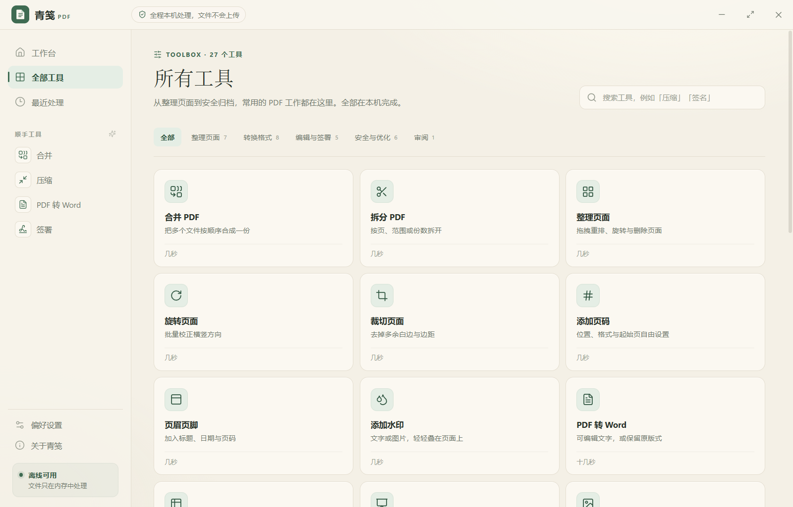
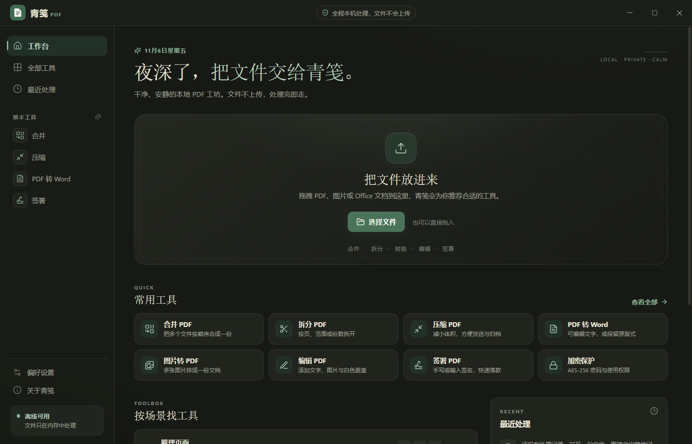
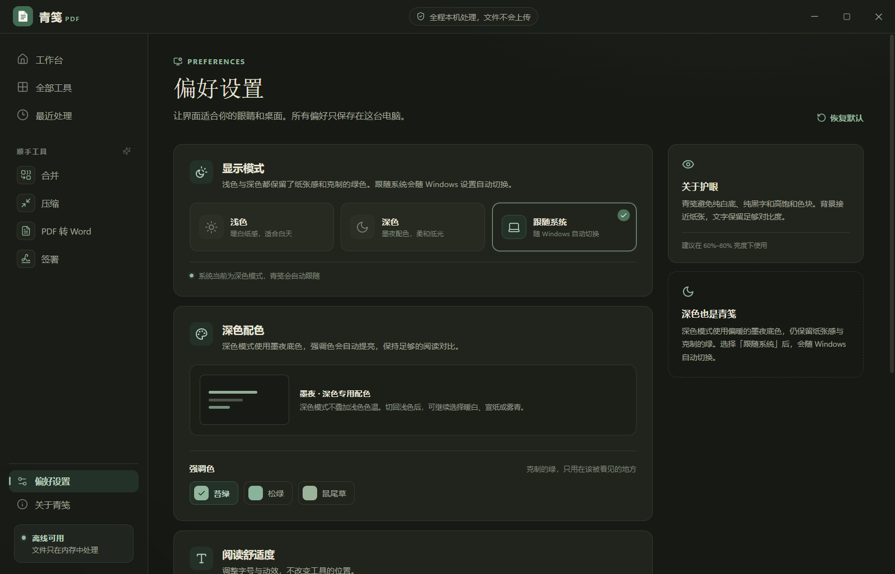
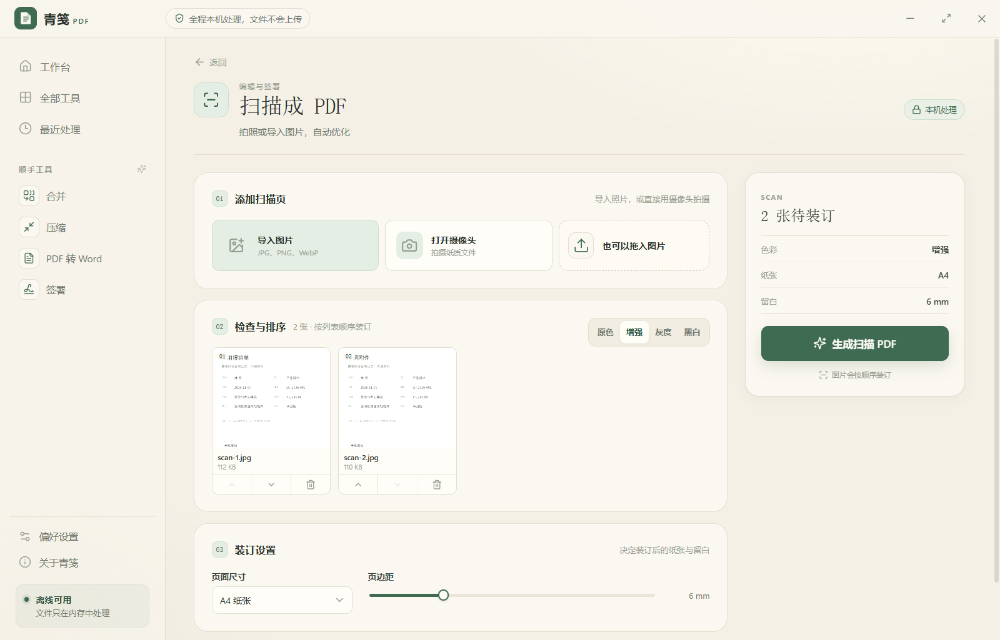
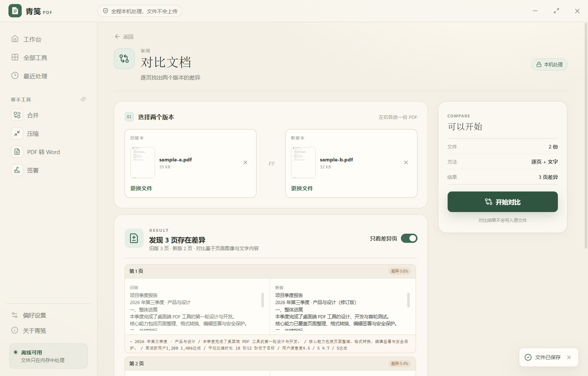

# 青笺 PDF

> 把 PDF 收拾得妥帖，也让眼睛舒服一点。

青笺是一款 **完全本机运行** 的 Windows PDF 办公工具。参考 iLovePDF 的工具结构，把日常最常用的 27 项 PDF 能力收进一个干净、安静、无边框的桌面客户端里。

- **暖白与墨夜双主题**：浅色低饱和、深色低光，长时间阅读不刺眼
- **浅色 / 深色 / 跟随系统**：跟随系统会随 Windows 设置自动切换
- **克制的苔绿强调色**：深色下自动提亮，只出现在需要被看见的地方
- **无边框窗口**：自绘标题栏与窗口按钮，内容更靠近使用者
- **没有账号、没有上传、没有追踪**：文件只在内存中处理，关闭窗口即释放

## 界面一览












## 下载与运行

打包后的便携版位于：

```text
release/Qingjian-PDF-1.1.0-portable.exe
```

双击即可运行，无需安装。第一次启动如果遇到 Windows SmartScreen 提示，请选择「更多信息 → 仍要运行」（应用未做商业代码签名）。

也可以从源码运行：

```bash
npm install
npm run dev
```

构建并打包：

```bash
npm run build
npm run dist
```

## 工具清单

### 整理页面

| 工具 | 能做什么 |
| --- | --- |
| 合并 PDF | 多个 PDF 按顺序拼接，页码连续重排 |
| 拆分 PDF | 逐页、按页码范围或每 N 页拆分，结果打包为 ZIP |
| 整理页面 | 拖拽重排、单页旋转、删除页面 |
| 旋转页面 | 90° / 180° / 270° 批量校正方向 |
| 裁切页面 | 按毫米设置四边留白，带实时预览 |
| 添加页码 | 起始页、格式、字号、边距、六种位置、跳过封面 |
| 页眉页脚 | 左中右三段文字，支持 `{page}`、`{total}`、`{date}`、`{title}` 占位符 |

### 转换格式

| 工具 | 能做什么 |
| --- | --- |
| PDF 转 Word | 可编辑文字或保留页面版式；可指定页面 |
| PDF 转 Excel | 按文字坐标自动分行分列，每页生成一个工作表 |
| PDF 转 PPT | 每页转为高清幻灯片，16:9 / 4:3 可选 |
| PDF 转图片 | JPG / PNG，96–300 DPI，逐页导出或打包 ZIP |
| 图片转 PDF | JPG / PNG / WebP 等，A4 / Letter / 跟随图片，自动方向 |
| Office 转 PDF | DOCX、XLSX、PPTX 本地重排后打印为 PDF |
| HTML 转 PDF | 网页链接、粘贴 HTML、本地 HTML 文件 |
| PDF 转 Markdown | 按字号推断标题层级，输出纯文本 Markdown |

### 编辑与签署

| 工具 | 能做什么 |
| --- | --- |
| 编辑 PDF | 添加文字、图片、白色遮盖；拖动与缩放 |
| 签署 PDF | 手写、输入或上传签名；拖动落款位置、签署人、日期 |
| 添加水印 | 文字或图片，透明度、旋转、居中或平铺 |
| 涂黑脱敏 | 框选敏感区域，导出永久栅格化的脱敏 PDF |
| 扫描成 PDF | 导入照片或调用摄像头拍摄，原色 / 增强 / 灰度 / 黑白 |

### 安全与优化

| 工具 | 能做什么 |
| --- | --- |
| 加密保护 | AES-256，打开密码、所有者密码与打印 / 复制 / 编辑权限 |
| 解除密码 | 输入已知密码，重建为无加密 PDF |
| PDF/A 归档 | PDF/A-1b / 2b / 3b 结构、输出意图与同步元数据 |
| 修复 PDF | 重建交叉引用与文档目录；严重损坏时逐页图像重建 |
| 压缩 PDF | 三档压缩，自动在「重排压缩」与「保留原结构」之间取更小结果 |
| OCR 文字识别 | 中文 + 英文离线识别，生成可搜索 PDF 或 TXT |

### 审阅

| 工具 | 能做什么 |
| --- | --- |
| 对比文档 | 逐页图像差异 + 文字内容对比，只看差异页 |

## 外观

- **浅色 / 深色 / 跟随系统** 三种显示模式，跟随系统时无需重启即可响应 Windows 主题变化。
- 浅色提供暖白、宣纸、雾青三种色温；深色使用统一的低光墨夜配色，并自动提亮苔绿、松绿与鼠尾草强调色。
- 偏好只保存在本机 `localStorage`，不会上传。

## 技术栈

- **Electron 38** + **React 19** + **TypeScript** + **Vite / electron-vite**
- **PDF.js**：页面渲染、文字提取、图像对比
- **@cantoo/pdf-lib**：合并、拆分、页面编辑、表单、AES-256 加密、PDF/A 元数据
- **docx / ExcelJS / PptxGenJS / mammoth**：Office 读写
- **Tesseract.js**：离线 OCR，内置 `chi_sim` 与 `eng` 模型
- **JSZip**：批量结果打包

## 隐私说明

- 应用没有任何账号、云端接口或遥测。
- PDF 的渲染、转换、加解密与 OCR 都在本机内存中完成。
- 「最近处理」只保存文件路径、文件名、大小与所用工具，不保存文件内容；可在偏好设置中关闭。
- 加密密码不会写入磁盘，也不会被应用记录。

## 已知边界

青笺在本地完成尽量多的能力，但一些格式转换不是 Adobe / Microsoft 的排版引擎，边界如下：

1. **PDF 转 Word / Excel** 是基于文字坐标的重排。复杂分栏、跨页表格、公式与图表可能需要手动调整。
2. **PDF 转 PPT** 将每页作为图片放入幻灯片，视觉一致，但文字不可在 PPT 中直接编辑。
3. **PPTX 转 PDF** 采用「文字 + 图片」的简洁重排，动画、图表与精确坐标不会保留；Word / Excel 采用 HTML 重排。
4. **PDF/A** 写入归档结构、ICC 输出意图与同步元数据，但不宣称通过正式合规认证。严格场景请使用 veraPDF 复核。
5. **OCR** 的效果取决于扫描质量；低清、倾斜或手写内容可能需要人工校对。
6. **修复** 只能恢复仍然存在于文件中的内容。若字体子集或图片数据已被截断，输出可能缺失或显示异常。
7. **PDF 加密** 使用 AES-256；忘记密码后，青笺无法恢复文件内容。
8. 扫描工具的摄像头功能依赖系统摄像头权限。

## 项目结构

```text
src/main/              Electron 主进程、窗口、文件对话框、HTML 打印
src/preload/           contextBridge 安全 API
src/renderer/          React 界面与本地 PDF 处理
  src/lib/             PDF 基础、页面操作、格式转换、OCR
  src/components/      工作台、工具页与自定义编辑器
resources/fonts/       中文字体（Source Han Sans）
src/renderer/public/tessdata/    OCR 语言模型
scripts/               样例生成、冒烟测试与端到端测试
```

## 第三方许可

见 [THIRD_PARTY_NOTICES.md](THIRD_PARTY_NOTICES.md)。中文字体为 Source Han Sans（SIL Open Font License 1.1），OCR 语言模型来自 tessdata_fast（Apache License 2.0）。

---

青笺与 iLovePDF 无隶属关系；工具分类仅作为产品结构参考。

---

源码仓库：[github.com/maeheelam-beep/qingjian-pdf](https://github.com/maeheelam-beep/qingjian-pdf)  
便携版下载：[Releases](https://github.com/maeheelam-beep/qingjian-pdf/releases)


